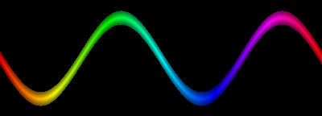
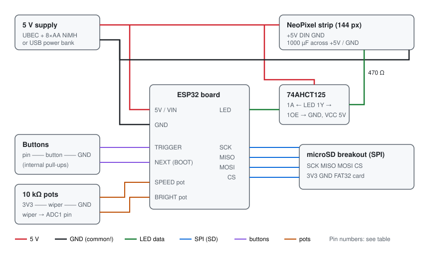
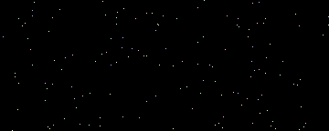
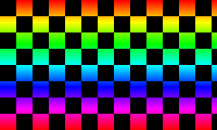
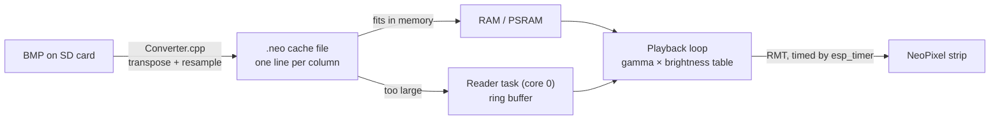

<h1 align="center">🎨 NeoPixel Painter for ESP32</h1>

<p align="center">
  <b>Paint pictures in the air with light.</b><br>
  An SD-card-driven light-painting stick for long-exposure photography,
  for the whole ESP32 family.
</p>

<p align="center">
  <a href="https://github.com/ShadowStacker/Neopixel-Painter-ESP32/actions/workflows/build.yml"></a>
  
  
  <a href="LICENSE"></a>
</p>

<p align="center">
  
  
  
</p>

---

Mount a NeoPixel strip on a stick, open your camera's shutter, press the
button and walk across the frame. The stick plays an image from the SD card
one column at a time, and the long exposure records it as a picture floating
in the air.

This project is a port of the
[Adafruit NeoPixel Painter](https://learn.adafruit.com/neopixel-painter) by
Phil Burgess. That project only runs on an Arduino Uno and depends on its
timer registers, so this is a rewrite for the **ESP32, ESP32-S2, ESP32-S3,
ESP32-C3 and ESP32-C6**. It keeps the original's controls and makes use of the
ESP32's extra memory and second core.

## Contents

- [Features](#-features)
- [Parts list](#-parts-list)
- [Wiring](#-wiring)
- [Installing the firmware](#-installing-the-firmware)
- [Preparing images](#%EF%B8%8F-preparing-images)
- [Taking a light painting](#-taking-a-light-painting)
- [Configuration](#%EF%B8%8F-configuration)
- [How it works](#-how-it-works)
- [Troubleshooting](#-troubleshooting)
- [Credits & license](#-credits--license)

## ✨ Features

- **Any ESP32 chip:** default pins for ESP32, S2, S3, C3 and C6.
- **Images used as-is:** what you see on screen is what appears in the photo.
  No rotating images in an editor first.
- **Any BMP name:** files play in alphabetical order. 24- and 32-bit, scaled to fit the strip.
- **Fast startup:** images are converted once and cached on the SD card.
- **Live controls:** the speed and brightness dials are read on every
  trigger press, with no reset needed.
- **Tap or hold:** tap to paint once, or hold to repeat the image until you let go.
- **Next button:** skip between images. By default it's the on-board BOOT button.
- **Power limiting:** brightness is capped so the strip stays within what your supply can deliver.
- **Steady timing:** images play from RAM or PSRAM. Larger ones are read from
  the SD card by a background task on the second core.
- **Status on the strip:** progress bar, image number and error blink. No screen needed.
- **Optional wheel/encoder:** advance one line per wheel pulse instead of using a timer.

| | Original (Arduino Uno) | This project (ESP32) |
|---|---|---|
| Image names | `frame000.bmp`... only | any `*.bmp` |
| Orientation | rotate 90° in an editor first | as-is (pre-rotated mode available) |
| Startup | converts all images at every boot | cached; reboots are instant |
| Brightness | set at power-up; reset to change | changeable at any time |
| Choosing images | sequential only | sequential + **Next** button |
| Feedback | serial only | shown on the strip + serial log |

## 🧰 Parts list

| Part | Notes |
|---|---|
| ESP32-family dev board | Boards with **PSRAM** (e.g. ESP32-S3 N8R8, WROVER) hold long images in RAM |
| NeoPixel strip | Default 144 pixels (1 m at 144/m). Any length works |
| microSD breakout (SPI) | e.g. Adafruit #254 / #4682. Card formatted FAT32 |
| 74AHCT125 level shifter | Converts the ESP32's 3.3 V data signal to the strip's 5 V |
| 1000 µF capacitor, 470 Ω resistor | Across strip power / in series with data |
| 2 momentary buttons | Trigger + Next (the BOOT button can serve as Next) |
| 2 × 10 kΩ potentiometers | Speed and brightness (both optional) |
| 5 V power supply | UBEC + 8×AA NiMH, or a high-current USB power bank |
| Rigid bar | Aluminium extrusion or wood molding to mount the strip |

## 🔌 Wiring

<p align="center"></p>

Buttons connect between the pin and **GND**; the internal pull-ups are used.
Potentiometers connect as 3V3 – wiper – GND. Every pin can be changed in
[`config.h`](NeoPixelPainterESP32/config.h).

| Function | ESP32 | ESP32-S3 | ESP32-S2 | ESP32-C3 | ESP32-C6 |
|---|:-:|:-:|:-:|:-:|:-:|
| NeoPixel data (via level shifter) | 13 | 5 | 5 | 10 | 10 |
| Trigger button | 27 | 6 | 6 | 3 | 11 |
| Next button | 0 (BOOT) | 0 (BOOT) | 0 (BOOT) | 9 (BOOT) | 9 (BOOT) |
| Speed pot | 34 | 1 | 1 | 0 | 0 |
| Brightness pot | 35 | 2 | 2 | 1 | 1 |
| SD SCK | 18 | 12 | 36 | 4 | 21 |
| SD MISO | 19 | 13 | 37 | 5 | 20 |
| SD MOSI | 23 | 11 | 35 | 6 | 19 |
| SD CS | 5 | 10 | 34 | 7 | 18 |

> [!WARNING]
> **Power the strip directly from the supply, not through the dev board.**
> 144 pixels at full white draw about 8.6 A. All grounds (supply, ESP32,
> level shifter, strip and SD card) must be connected together.

> [!TIP]
> Without the level shifter the strip may work on the bench but flicker or
> show random colours in the field. Fit one.

## 💾 Installing the firmware

### Arduino IDE

1. Install **esp32 by Espressif Systems** in the Boards Manager (3.x recommended; 2.x also works).
2. Install **Adafruit NeoPixel** in the Library Manager.
3. Open [`NeoPixelPainterESP32/NeoPixelPainterESP32.ino`](NeoPixelPainterESP32/NeoPixelPainterESP32.ino).
4. Check the pins and strip length in `config.h`.
5. Select your board. If it has PSRAM, enable it under *Tools → PSRAM*. Then upload.

### PlatformIO

```bash
pio run -e esp32-s3 -t upload
```
```bash
pio device monitor
```

Available environments: `esp32dev`, `esp32-wrover`, `esp32-s3`, `esp32-s2`, `esp32-c3`, `esp32-c6`.

## 🖼️ Preparing images

1. Format the SD card as **FAT32**.
2. Copy your `.bmp` files to the root folder of the card. The [`examples/`](examples)
   folder has ready-made test images. Run `python3 tools/make_examples.py` to
   generate them for a different strip length.
3. Insert the card and power up. On first boot each image is converted, shown
   by a **green progress bar** on the strip, and cached in `/_painter_cache/`.

Tips for good images:

- **Height = strip length** (144 px by default). Other heights are scaled to fit.
- **Width = how long the painting is:** each column is one painted line.
- **Use black backgrounds.** Black pixels are off, so they don't show in the photo.
- Export as **24-bit uncompressed BMP**. In GIMP: *Export As → .bmp → Advanced → 24 bits R8 G8 B8*.
- Files play in alphabetical order. Name animation frames `frame000.bmp`, `frame001.bmp`, and so on.
- Images made for the original Adafruit project are pre-rotated. Set `IMAGE_PREROTATED 1` for those.

| Example | Preview |
|---|---|
| `01_rainbow.bmp` |  |
| `02_sine_wave.bmp` |  |
| `03_heart.bmp` |  |
| `04_stars.bmp` |  |
| `05_checker.bmp` |  |

## 📸 Taking a light painting

1. Put the camera on a tripod somewhere dark. Use manual mode, a **5–30 s exposure**, around **f/8** and low ISO.
2. Turn the **brightness** dial down to start with. A photo needs much less light than you'd think.
3. Set the **speed** dial. Slower gives a wider painting; faster gives a narrower one.
4. Open the shutter, press **Trigger** and walk steadily across the frame, holding the stick upright.

| Control | Action |
|---|---|
| **Trigger: tap** | Paint the image once, then select the next image (handy for animation frames) |
| **Trigger: hold** | Repeat the image until released (the current pass finishes) |
| **Next** | Skip to the next image. A dim blue bar shows its number |
| **Trigger held at power-up** | Re-convert all images |

The strip shows status as follows:

| Strip shows | Meaning |
|---|---|
| 🟩 Green bar growing | Converting images |
| 🟦 Short blue bar | Image selected (bar length = image number) |
| 🟥 4 pixels blinking red | Error. The serial monitor (115200 baud) says why |
| ⬛ Dark | Ready to paint |

## ⚙️ Configuration

All settings are in [`config.h`](NeoPixelPainterESP32/config.h):

| Setting | Default | Description |
|---|---|---|
| `N_LEDS` | `144` | Number of pixels |
| `LED_TYPE` | `NEO_GRB + NEO_KHZ800` | Colour order / type. Use `NEO_GRBW` etc. for other strips |
| `LED0_AT_TOP` | `0` | Which end of the stick the data input is on |
| `CURRENT_MAX` | `3500` | mA available for the LEDs; brightness is capped to stay under it |
| `CONSISTENT_BRIGHTNESS` | `1` | Use the same cap for all images, so animations stay even |
| `GAMMA` | `2.6` | Gamma correction |
| `IMAGE_PREROTATED` | `0` | `1` = images rotated 90° CCW (original project format) |
| `SCALE_TO_FIT` | `1` | `0` = centre and crop instead of scaling |
| `MIN_LPS` / `MAX_LPS` | `10` / `400` | Speed dial range, in lines per second |
| `ENCODER_PIN` / `ENCODER_STEPS` | off | Advance lines from a measuring wheel |
| `SD_SPI_HZ` | `20000000` | Lower it if the SD card is unreliable |

No pots fitted? Set `PIN_SPEED_POT` / `PIN_BRIGHTNESS_POT` to `-1`. The sketch then
uses `DEFAULT_LPS` and `DEFAULT_BRIGHTNESS`.

## 🧠 How it works



1. **Conversion.** Each image column becomes one line of `N_LEDS × RGB`
   bytes, resampled to the strip length. The work is done in chunks, so it
   needs little RAM. The brightest line is measured and recorded for power
   limiting.
2. **Loading.** Images that fit are preloaded into PSRAM or RAM. Larger
   images are streamed by a FreeRTOS task on the other core into a 128-line
   buffer, so SD card delays don't interrupt the LED timing.
3. **Playback.** Each line goes through a 256-entry gamma × brightness table
   and out through the ESP32's RMT peripheral at precise intervals. Because
   brightness is applied at playback rather than during conversion, the
   brightness dial works without re-converting images.

<details>
<summary><b>Project layout</b></summary>

```
NeoPixelPainterESP32/
├── NeoPixelPainterESP32.ino  main sketch: setup, controls, playback
├── config.h                  all settings and pin assignments
├── Converter.cpp/.h          BMP → .neo conversion and cache check
└── ImageSource.cpp/.h        RAM preload or streamed playback source
examples/                     sample images for the SD card
tools/make_examples.py        sample image generator (any strip length)
docs/                         wiring diagram and image previews
platformio.ini                PlatformIO environments
```
</details>

## 🛠 Troubleshooting

| Symptom | Fix |
|---|---|
| Red blink at startup | Check the serial monitor. Usually the SD card is missing or not FAT32, or the `PIN_SD_*` settings don't match your wiring |
| An image is skipped | It isn't a 24/32-bit uncompressed BMP. Re-export it |
| Wrong colours | Change `LED_TYPE` (e.g. `NEO_RGB`) |
| Image upside down | Toggle `LED0_AT_TOP` |
| Image mirrored | Walk the other way, or flip the image horizontally |
| Flicker / random colours | Fit the level shifter, resistor and capacitor; keep the data wire short |
| Power supply cuts out | Lower `CURRENT_MAX` |
| `SD underruns` in the log | Use a faster card, raise `STREAM_RING_LINES`, or use a board with PSRAM |

## 🙏 Credits & license

Based on the **Adafruit NeoPixel Painter** by Phil Burgess / Paint Your
Dragon for Adafruit Industries ([guide](https://learn.adafruit.com/neopixel-painter),
[original code](https://github.com/adafruit/NeoPixel_Painter)). Please support
Adafruit by buying their products.

Released under the [BSD 3-Clause License](LICENSE), as the original.
